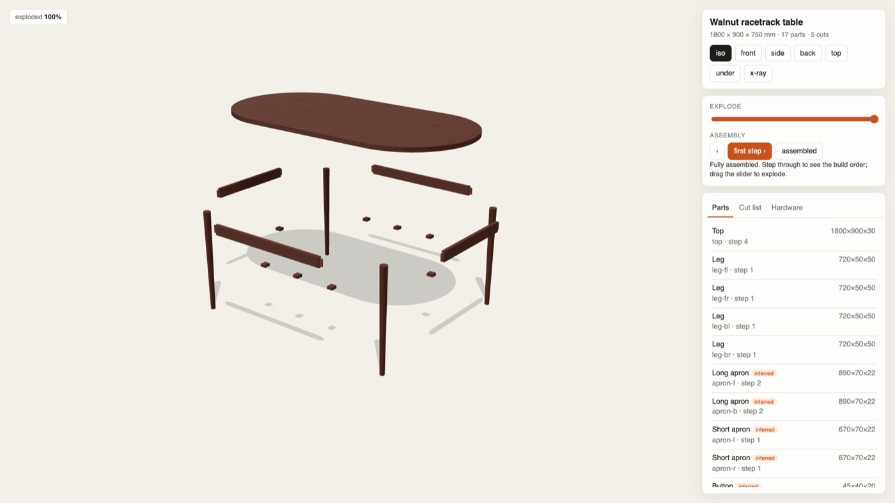
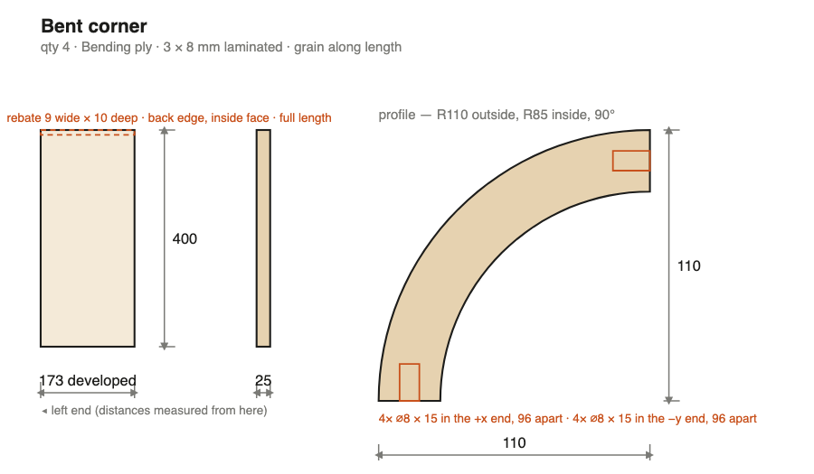
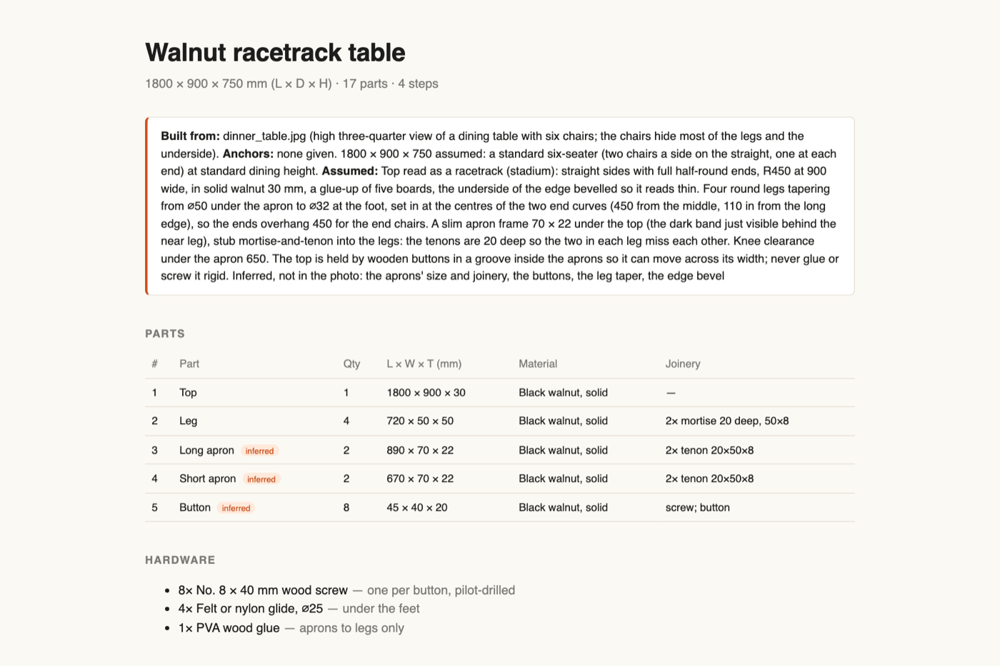
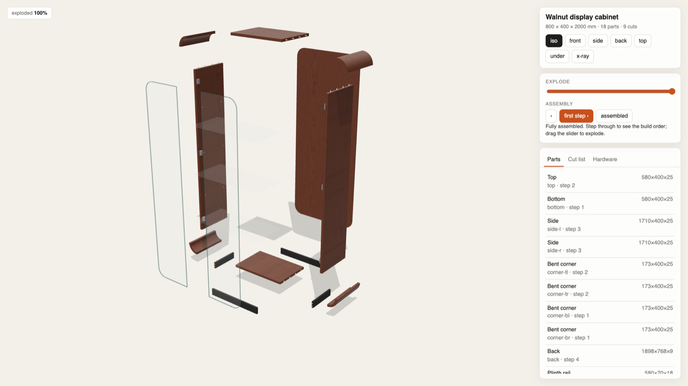
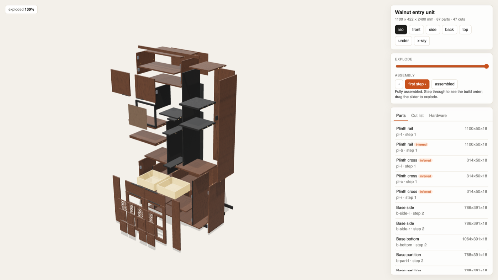
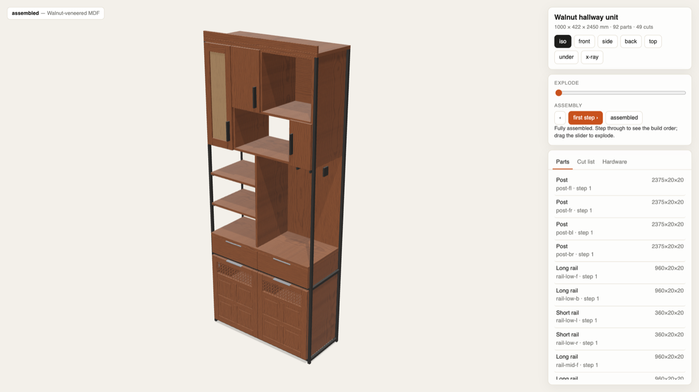
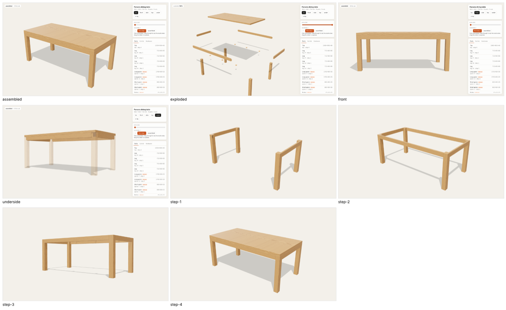

# joinery

A Claude Code skill that turns a furniture photo into something a carpenter can build.

Send a picture and one or two real dimensions. Claude reads the piece, writes it as a parametric model with every part as real stock and real joinery, and builds one offline HTML page where it comes apart piece by piece. It also writes the maker pack: cut list, dimensioned shop drawings, what wood to buy, hardware, and an illustrated step-by-step assembly manual. The page and the paper come from the same model, so they cannot disagree.



## Install

```
npx skills add JoseChipanaTica/joinery -g -a claude-code
```

or clone it straight into your skills folder:

```
git clone https://github.com/JoseChipanaTica/joinery ~/.claude/skills/joinery
```

Then, once, in the installed folder:

```
npm install && npx playwright install chromium
```

You need Node.js 20.10 or newer. Chromium is only used to render review stills and the images in the manual. If Playwright's Chromium will not download or launch, point `CHROMIUM` at any Chrome or Chromium binary (`export CHROMIUM="/Applications/Google Chrome.app/Contents/MacOS/Google Chrome"`).

## Use

Ask Claude Code in plain words, with a photo attached:

> Here's a table I like. It's about 180 cm long. Make me plans a carpenter can build from.

> Rebuild this bookshelf in birch ply for a 2.4 m wall, and give me the cut list.

> How is this chair put together? Show me exploded and step by step.

Claude asks for a real dimension if you didn't give one, writes down every assumption it makes about what the photo can't show, and reviews its own renders before handing over the page and the pack.

## What you get

**One offline page per piece** (about 570 KB, three.js inlined). Drag a slider and it explodes. Step through the assembly, x-ray the underside, click a part to read its stock size, or leave it alone for 20 seconds and it tours itself.

**The maker pack**, all in `joinery-out/<piece>/`:

| File | What it is |
|---|---|
| `cutlist.csv` `cutlist.md` | Every part with finished size, material, grain direction and joinery. Tenon lengths are included in the stock. |
| `drawings/*.svg` `assembly.svg` | One dimensioned drawing per unique part. Every mortise, dado, groove and hole names its face and its distance from the end. |
| `stock.md` `sheet-*.svg` | What to buy: boards grouped by thickness with waste allowed, glue-ups and laminations planned, sheet goods nested on 2440 × 1220 sheets. |
| `manual.html` | Assumptions first, then parts, hardware, and one illustrated page per assembly step. |
| `validation.txt` | Errors stop the pack: parts passing through each other, joints that don't touch, loose parts, a piece that floats, tenons breaking through or meeting inside a leg. Warnings are listed for the maker: odd stock thickness, short grain, a wide top glued rigid, heights outside the usual range. |

| Shop drawing | Assembly manual |
|---|---|
|  |  |

## Examples

Five complete pieces ship with the skill. Each is a `spec.json` (what the photo gave and what was assumed), a `model.js` (the piece as a function of its parameters) and a `main.js`.

| | |
|---|---|
|  |  |
| **Walnut display cabinet**, 800 × 400 × 2000. Bent-plywood corners laminated over a form, frameless glass doors on clamp hinges, glass shelves on pins. 18 parts. | **Walnut entry unit**, 1100 × 400 × 2400. A floor-to-ceiling built-in: shoe cabinet, drawers on runners, frame-and-panel doors, floating shelves, a coat tower. 87 parts. |
|  |  |
| **Walnut hallway unit**, 1000 × 400 × 2450. A welded steel frame holding three walnut boxes, cane-panel door, lit shelves. 92 parts. | **Parsons table**, 1800 × 900 × 750. The smallest complete piece and the one to read first. This is the review sheet Claude reads before it reports a piece as done. 15 parts. |

The walnut racetrack table at the top (1800 × 900 × 750, round tapered legs, a stadium top held on buttons) is the fifth.

Build and pack any of them:

```
node build.mjs walnut-display-cabinet               # joinery-out/dist/walnut-display-cabinet.html
node pack.mjs walnut-display-cabinet                # joinery-out/walnut-display-cabinet/
node capture.mjs walnut-display-cabinet --stills steps   # review sheet
npm test                                            # build and validate all five
```

## How it works

```
photo + anchors ─► spec.json ─► model.js ─► validate ─► page ─► stills ─► pack
```

1. **Read the photo honestly.** A single photo has no scale and no hidden structure. Claude asks for one to three real dimensions, reads every other size as a proportion, and marks every part it cannot see (aprons under a top, backs, runners) as `inferred` so the maker knows which ones to check.
2. **Model it.** Each part is a box of real stock in its assembled position, with grain direction, material and edge. Curved parts carry their real profile. Joints connect two parts and write matching features onto both (a tenon lengthens the stock, the mortise appears on the leg's drawing).
3. **Validate.** Two parts may only touch through a declared joint, every part is joined to the rest, and nothing floats. Thickness should land on a stock size and wide solid tops must be free to move. When packing, anything wider than 200 mm becomes a planned glue-up and anything thicker than 50 mm a lamination.
4. **Build, look, fix.** Claude renders a contact sheet of every view and step, compares it with the photo, changes a number and renders again until a pass finds nothing.
5. **Pack.** Cut list, drawings, stock and manual are all generated from the same model.

The full rules are in [`SKILL.md`](SKILL.md).

## What is inside

| | |
|---|---|
| `SKILL.md` | What Claude reads: how to read a photo honestly, how a piece is modelled, the rules that decide whether it can be built, the review loop. |
| `kit/model.js` | The pure model: boxes, profiles, joints → features, steps, stock sizes. No three.js. |
| `kit/validate.js` | Collisions, joints that don't touch, tenons that collide in a leg, short grain, wood movement, ergonomics. |
| `kit/cutlist.js` `kit/drawings.js` `kit/nest.js` `kit/manual.js` | The maker pack, all reading the same model. |
| `kit/stage.js` `kit/live.js` | Studio lighting, procedural wood shader (figure along the grain, end grain on the ends), and the page: explode, steps, isolate, x-ray, auto tour. |
| `examples/` | Five complete pieces. |
| `templates/` | The spec schema and the joinery library (which joint for which connection, per shop). |
| `build.mjs` `capture.mjs` `pack.mjs` | Bundle to one HTML file, render stills, write the pack. |

## Limits

- **This is design interpretation, not measurement.** From one photo the proportions are close; hidden structure is a sensible guess written down as one. Check every `inferred` part before cutting.
- **It is not engineering.** The validator checks geometry and woodworking rules, not loads. Tall pieces must be fixed to the wall, glass must be toughened, and anything carrying people or heavy loads should be checked by someone qualified. Electrical work (LED drivers, sockets) is for an electrician.
- **Parts are boxes or straight extrusions.** Bent corners, round and tapered legs and radiused panels work. A part curved in two directions, like a carved chair back, does not yet.
- **Metric.** Sizes are in millimetres and stock is metric.

## Roadmap

- **Compound curves.** A body type for parts curved in two directions, so chairs with carved backs can be built.
- **CNC.** `kit/drawings.js` already has every cut as a rectangle on a face; a DXF writer per part is the next step.
- **Photoreal stills.** Export the same parts to glTF and render in Blender Cycles with a scanned wood material, keeping the model as the single source.
- **Several photos.** Run them through an external photogrammetry reconstruction first and use its measurements as anchors; the rest of the pipeline stays the same.

## Contributing

New pieces, materials, joints and corrections from people who build furniture are all welcome. See [CONTRIBUTING.md](CONTRIBUTING.md).

## Credits

Pipeline shape (reference first, one parameter block, build-and-screenshot review loop) after [elvarofficial/teardown](https://github.com/elvarofficial/teardown) and [whaleyxbt/claude-motion](https://github.com/whaleyxbt/claude-motion), both MIT.

## License

[MIT](LICENSE) © 2026 Jose Paul Chipana Tica
